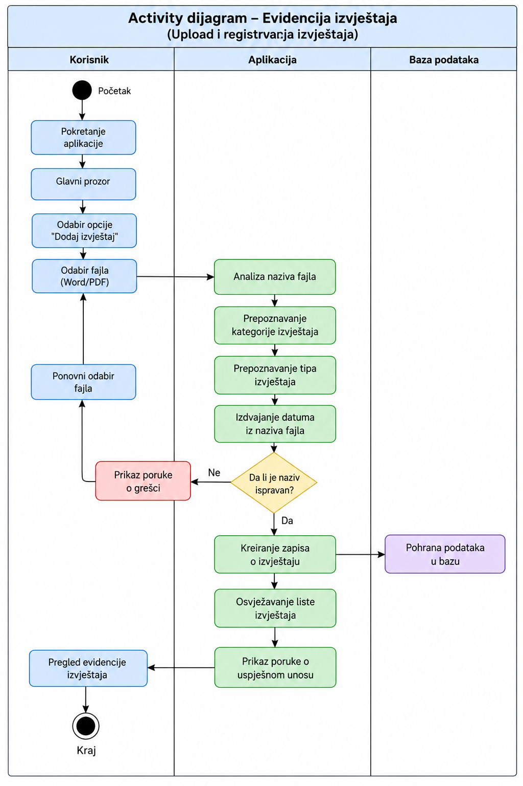
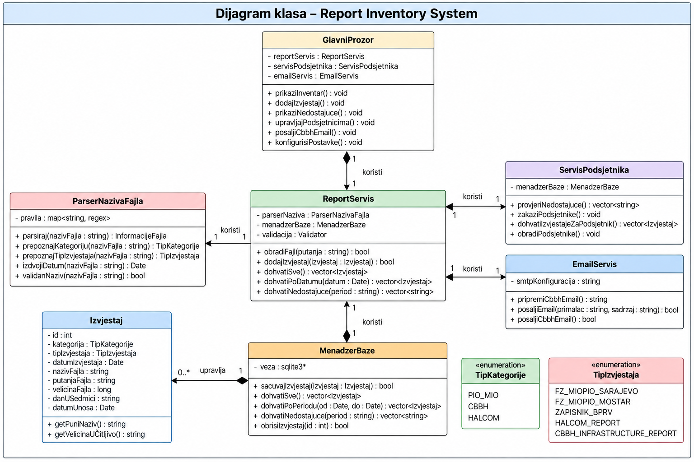

# Report Inventory System

## Milestone 1 – Analiza zahtjeva i dizajn projekta

## 1. Uvod

**Report Inventory System** je desktop aplikacija namijenjena za organizaciju, evidenciju i praćenje redovnih izvještaja koji se izrađuju dva puta mjesečno.

Cilj sistema je omogućiti jednostavno dodavanje Word i PDF izvještaja, automatsko prepoznavanje njihove kategorije, tipa i datuma na osnovu naziva fajla, trajno čuvanje podataka o izvještajima te pregled nedostajućih izvještaja.

Pored osnovne evidencije, aplikacija treba podržati podsjetnike za redovne datume izvještavanja, podsjetnik za najavu odlaska u Centralnu banku Bosne i Hercegovine (CBBH) te pripremu i slanje testnog emaila za CBBH najavu.

---

## 2. Funkcionalni zahtjevi

Aplikacija treba omogućiti:

- desktop grafički korisnički interfejs;
- dodavanje Word i PDF izvještaja;
- automatsko prepoznavanje kategorije izvještaja na osnovu naziva fajla;
- automatsko prepoznavanje tipa izvještaja;
- automatsko izdvajanje datuma iz naziva fajla;
- trajno spremanje podataka o izvještajima;
- prikaz datuma izvještaja;
- prikaz dana u sedmici;
- evidenciju veličine fajla;
- evidenciju naziva i lokacije fajla;
- pregled evidentiranih izvještaja;
- pregled nedostajućih izvještaja;
- podsjetnike za 12. i 22. dan u mjesecu;
- podsjetnik za najavu odlaska u CBBH;
- pripremu i slanje testnog emaila za CBBH najavu.

---

## 3. Kategorije izvještaja

Sistem podržava tri osnovne kategorije izvještaja:

- **PIO/MIO**
- **CBBH**
- **Halcom**

### 3.1. PIO/MIO

Očekivani izvještaji:

1. `Izvještaj FZ MIOPIO SARAJEVO dd.mm.yyyy`
2. `Izvještaj FZ MIOPIO MOSTAR dd.mm.yyyy`

### 3.2. CBBH

Očekivani izvještaj:

3. `Zapisnik pregleda sistema BPRV dd.mm.yyyy`

### 3.3. Halcom

Očekivani izvještaji:

4. `report dd.mm.yyyy`
5. `CBBH Infrastructure Report yyyy-mm-dd`

Prema tome, sistem očekuje ukupno **pet različitih tipova izvještaja po jednom izvještajnom periodu**.

---

## 4. Očekivani izvještaji po izvještajnom periodu

| ID | Kategorija | Tip izvještaja | Format naziva fajla |
|---|---|---|---|
| 1 | PIO/MIO | MIOPIO Sarajevo | `Izvještaj FZ MIOPIO SARAJEVO dd.mm.yyyy` |
| 2 | PIO/MIO | MIOPIO Mostar | `Izvještaj FZ MIOPIO MOSTAR dd.mm.yyyy` |
| 3 | CBBH | BPRV zapisnik | `Zapisnik pregleda sistema BPRV dd.mm.yyyy` |
| 4 | Halcom | Halcom report | `report dd.mm.yyyy` |
| 5 | Halcom | Infrastructure report | `CBBH Infrastructure Report yyyy-mm-dd` |

Izvještaji se izrađuju dva puta mjesečno. Sistem treba omogućiti provjeru da li su za određeni izvještajni period evidentirani svi očekivani izvještaji.

---

## 5. Pravila za prepoznavanje naziva fajlova

Prilikom dodavanja izvještaja aplikacija analizira naziv odabranog fajla.

Na osnovu definisanih pravila sistem određuje:

- kategoriju izvještaja;
- tip izvještaja;
- datum izvještaja.

### 5.1. MIOPIO Sarajevo

Ako naziv odgovara obrascu:

`Izvještaj FZ MIOPIO SARAJEVO dd.mm.yyyy`

sistem određuje:

- kategorija: `PIO/MIO`
- tip izvještaja: `MIOPIO Sarajevo`
- format datuma: `dd.mm.yyyy`

### 5.2. MIOPIO Mostar

Ako naziv odgovara obrascu:

`Izvještaj FZ MIOPIO MOSTAR dd.mm.yyyy`

sistem određuje:

- kategorija: `PIO/MIO`
- tip izvještaja: `MIOPIO Mostar`
- format datuma: `dd.mm.yyyy`

### 5.3. CBBH BPRV

Ako naziv odgovara obrascu:

`Zapisnik pregleda sistema BPRV dd.mm.yyyy`

sistem određuje:

- kategorija: `CBBH`
- tip izvještaja: `BPRV zapisnik`
- format datuma: `dd.mm.yyyy`

### 5.4. Halcom report

Ako naziv odgovara obrascu:

`report dd.mm.yyyy`

sistem određuje:

- kategorija: `Halcom`
- tip izvještaja: `Halcom report`
- format datuma: `dd.mm.yyyy`

### 5.5. CBBH Infrastructure Report

Ako naziv odgovara obrascu:

`CBBH Infrastructure Report yyyy-mm-dd`

sistem određuje:

- kategorija: `Halcom`
- tip izvještaja: `Infrastructure report`
- format datuma: `yyyy-mm-dd`

### 5.6. Neispravan naziv fajla

Ako naziv fajla ne odgovara nijednom definisanom pravilu, aplikacija treba prikazati poruku o grešci i omogućiti korisniku da odabere drugi fajl.

Ekstenzija fajla (`.pdf`, `.doc` ili `.docx`) ne predstavlja dio naziva koji se koristi za određivanje tipa izvještaja i datuma.

---

## 6. Podaci koji se čuvaju za svaki izvještaj

Za svaki evidentirani izvještaj potrebno je trajno čuvati sljedeće podatke:

| Polje | Opis |
|---|---|
| `id` | Jedinstveni identifikator izvještaja |
| `category` | Kategorija izvještaja |
| `report_type` | Tip izvještaja |
| `report_date` | Datum izdvojen iz naziva fajla |
| `day_of_week` | Dan u sedmici za datum izvještaja |
| `file_name` | Originalni naziv fajla |
| `file_path` | Lokacija fajla |
| `file_size` | Veličina fajla |
| `file_extension` | Ekstenzija fajla |
| `upload_date` | Datum i vrijeme dodavanja u sistem |

Ovi podaci omogućavaju evidenciju, pregled i pretragu izvještaja, kao i određivanje nedostajućih izvještaja za određeni period.

---

## 7. Osnovni tok aplikacije

Osnovni tok dodavanja i evidentiranja izvještaja je sljedeći:

1. Korisnik pokreće aplikaciju.
2. Prikazuje se glavni prozor aplikacije.
3. Korisnik bira opciju **Dodaj izvještaj**.
4. Korisnik odabire Word ili PDF fajl.
5. Aplikacija analizira naziv fajla.
6. Sistem pokušava prepoznati kategoriju izvještaja.
7. Sistem pokušava prepoznati tip izvještaja.
8. Sistem izdvaja datum iz naziva fajla.
9. Provjerava se ispravnost naziva.
10. Ako naziv nije ispravan, korisniku se prikazuje poruka o grešci.
11. Korisnik može ponovo odabrati fajl.
12. Ako je naziv ispravan, kreira se zapis o izvještaju.
13. Podaci o izvještaju se pohranjuju u bazu podataka.
14. Lista evidentiranih izvještaja se osvježava.
15. Korisniku se prikazuje poruka o uspješnom unosu.
16. Korisnik može pregledati evidenciju izvještaja.

### 7.1. Activity dijagram

Activity dijagram prikazuje osnovni tok dodavanja i evidentiranja izvještaja, od odabira fajla do pohrane podataka u bazu.



---

## 8. Dizajn klasa i struktura sistema

Sistem je podijeljen na više klasa sa jasno definisanim odgovornostima.

### 8.1. `GlavniProzor`

Predstavlja glavni grafički korisnički interfejs aplikacije.

Njegove odgovornosti uključuju:

- prikaz inventara izvještaja;
- pokretanje dodavanja novog izvještaja;
- prikaz nedostajućih izvještaja;
- upravljanje podsjetnicima;
- pokretanje CBBH email funkcionalnosti.

### 8.2. `ReportServis`

Predstavlja centralni servis poslovne logike aplikacije.

Njegove odgovornosti uključuju:

- obradu odabranog fajla;
- komunikaciju sa parserom naziva fajla;
- komunikaciju sa bazom podataka;
- dodavanje izvještaja;
- dohvat evidentiranih izvještaja;
- određivanje nedostajućih izvještaja.

### 8.3. `ParserNazivaFajla`

Odgovoran je za analizu naziva fajla.

Njegove glavne funkcionalnosti su:

- prepoznavanje kategorije;
- prepoznavanje tipa izvještaja;
- izdvajanje datuma;
- validacija naziva fajla.

### 8.4. `MenadzerBaze`

Odgovoran je za komunikaciju sa SQLite bazom podataka.

Omogućava:

- spremanje izvještaja;
- dohvat svih izvještaja;
- dohvat izvještaja za određeni period;
- provjeru nedostajućih izvještaja;
- brisanje izvještaja.

### 8.5. `Izvjestaj`

Predstavlja model jednog izvještaja.

Sadrži podatke kao što su:

- ID;
- kategorija;
- tip izvještaja;
- datum izvještaja;
- naziv fajla;
- putanja fajla;
- veličina fajla;
- dan u sedmici;
- datum unosa.

### 8.6. `ServisPodsjetnika`

Odgovoran je za funkcionalnosti vezane za podsjetnike.

Sistem treba podržati:

- provjeru nedostajućih izvještaja;
- podsjetnike za 12. i 22. dan u mjesecu;
- podsjetnik za najavu odlaska u CBBH.

### 8.7. `EmailServis`

Odgovoran je za pripremu i slanje testnog emaila za CBBH najavu.

### 8.8. `TipKategorije`

Enumeracija `TipKategorije` definiše tri podržane kategorije:

```text
PIO_MIO
CBBH
HALCOM
```

### 8.9. `TipIzvjestaja`

Enumeracija `TipIzvjestaja` definiše pet podržanih tipova izvještaja:

```text
FZ_MIOPIO_SARAJEVO
FZ_MIOPIO_MOSTAR
ZAPISNIK_BPRV
HALCOM_REPORT
CBBH_INFRASTRUCTURE_REPORT
```

### 8.10. Dijagram klasa

Dijagram klasa prikazuje glavne klase sistema, njihove atribute, metode i međusobne veze.



---

## 9. Predložene tehnologije

Za realizaciju projekta predlažu se sljedeće tehnologije:

| Tehnologija | Namjena |
|---|---|
| **C++17** | Programski jezik |
| **Qt 6** | Desktop grafički korisnički interfejs |
| **SQLite** | Lokalna baza podataka |
| **CMake** | Build i konfiguracija projekta |
| **Git** | Version control |

### C++17

C++ predstavlja osnovni programski jezik projekta.

### Qt 6

Qt će se koristiti za izradu grafičkog korisničkog interfejsa desktop aplikacije.

Također pruža funkcionalnosti korisne za rad sa:

- fajlovima;
- datumima;
- bazama podataka;
- grafičkim komponentama.

### SQLite

SQLite će se koristiti za trajno spremanje podataka o izvještajima.

Pogodna je za ovaj projekat jer:

- baza može biti lokalna;
- ne zahtijeva poseban database server;
- jednostavna je za korištenje u desktop aplikaciji;
- dovoljna je za očekivanu količinu podataka.

### CMake

CMake će se koristiti za konfiguraciju i build C++ projekta.

### Git

Git će se koristiti za version control i praćenje promjena kroz milestoneove projekta.


---

## 10. Predložena struktura projekta

Planirana struktura projekta je:

```text
ReportInventorySystem/
|
|-- CMakeLists.txt
|-- README.md
|
|-- docs/
|   |-- analiza-zahtjeva.md
|   |
|   `-- images/
|       |-- DijagramAktivnosti1.png
|       `-- ClassDiagram.png
|
|-- src/
|   |-- main.cpp
|   |
|   |-- models/
|   |   `-- Izvjestaj.*
|   |
|   |-- services/
|   |   |-- ReportServis.*
|   |   |-- ParserNazivaFajla.*
|   |   |-- ServisPodsjetnika.*
|   |   `-- EmailServis.*
|   |
|   |-- database/
|   |   `-- MenadzerBaze.*
|   |
|   `-- ui/
|       `-- GlavniProzor.*
|
|-- tests/
|
|-- data/
|   `-- reports.db
|
`-- resources/
```

Struktura projekta može se prilagođavati tokom narednih milestoneova u zavisnosti od razvoja i potreba aplikacije.

---

## 11. Osnovna arhitektura sistema

Aplikacija je logički podijeljena na nekoliko dijelova.

### 11.1. Korisnički interfejs

UI sloj omogućava korisniku interakciju sa aplikacijom.

Ovaj sloj je prvenstveno predstavljen klasom `GlavniProzor`.

### 11.2. Poslovna logika

Poslovna logika obrađuje izvještaje i koordinira rad ostalih komponenti sistema.

Glavna klasa ovog sloja je `ReportServis`.

### 11.3. Obrada naziva fajlova

`ParserNazivaFajla` analizira naziv odabranog fajla i iz njega pokušava dobiti:

- kategoriju;
- tip izvještaja;
- datum.

### 11.4. Sloj za pristup podacima

`MenadzerBaze` predstavlja vezu između aplikacije i SQLite baze podataka.

Njegov zadatak je trajno spremanje i učitavanje podataka o izvještajima.

### 11.5. Automatizacija

Automatizacijski dio sistema obuhvata:

- podsjetnike;
- provjeru nedostajućih izvještaja;
- CBBH najavu;
- pripremu i slanje testnog emaila.

Za ove funkcionalnosti predviđene su klase `ServisPodsjetnika` i `EmailServis`.

---

## 12. Zaključak

U okviru **Milestone 1** izvršena je analiza zahtjeva i definisan je osnovni dizajn projekta **Report Inventory System**.

Definisani su:

- funkcionalni zahtjevi aplikacije;
- tri kategorije izvještaja;
- pet očekivanih tipova izvještaja;
- pravila za prepoznavanje naziva fajlova;
- pravila za izdvajanje datuma;
- podaci koji se čuvaju za svaki izvještaj;
- osnovni tok rada aplikacije;
- Activity dijagram;
- osnovne klase sistema;
- dijagram klasa;
- predložene tehnologije;
- struktura projekta;
- osnovna arhitektura sistema.

Ovaj dokument predstavlja osnovu za implementaciju funkcionalnosti u narednim milestoneovima projekta.